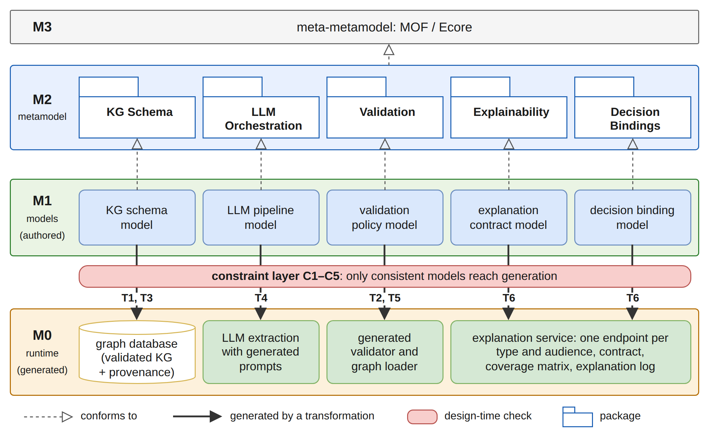
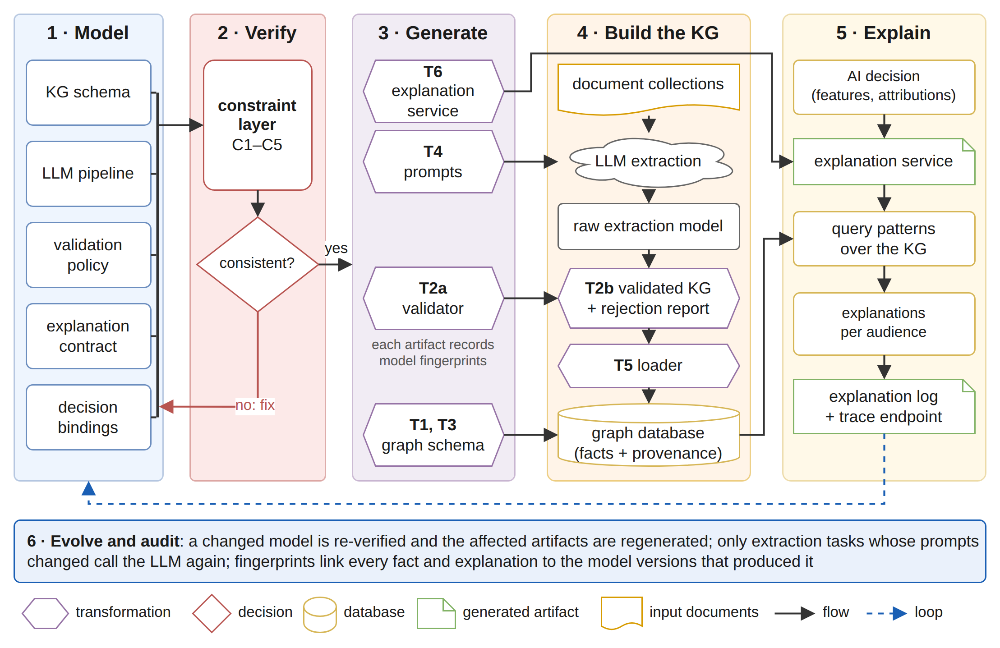

# The KnowMoDE framework: architecture and six phases

This page maps the framework of the paper (Section 4) to the repository: where each layer of the architecture lives and which command realizes each of the six phases.

## Four-layer architecture

| Layer | Content | In this repository |
|---|---|---|
| **M3** meta-metamodel | MOF/Ecore, reused unchanged | provided by EMF (dependency of [`xaikg-mde`](../xaikg-mde/pom.xml)) |
| **M2** metamodels | the XAI-KG metamodel (one package per concern) and three auxiliary metamodels for intermediate models | [`xaikg-mde/metamodels/`](../xaikg-mde/metamodels/) — see [metamodel.md](metamodel.md) and [transformations.md](transformations.md) |
| **M1** models | the five models authored by the designers of the information system; the only artifacts that carry domain knowledge | [`models/diabetes-readmission/`](../models/diabetes-readmission/) — see [models.md](models.md) |
| **M0** runtime | every artifact that encodes a schema element, rule, prompt or contract is **generated**; it runs on a model-independent kernel (LLM client, database driver, template engine) | generated artifacts: [`generated/`](../generated/); kernel: [`xaikg-pipeline/xaikg/`](../xaikg-pipeline/xaikg/) — see [runtime.md](runtime.md) |

The constraint layer ([constraints.md](constraints.md)) sits between M1 and M0: transformations only run on models that satisfy it. Since the runtime kernel never reads the M1 models, generated artifacts are the only channel through which design decisions reach the running system, which is why checks made at design time also hold at runtime. (Two auxiliary tools outside the generated pipeline, predictor training and corpus acquisition, read the decision-bindings model directly; see [runtime.md](runtime.md).)

## The six phases

| Phase (paper section) | What happens | Command | Code | Output |
|---|---|---|---|---|
| **1. Modeling the pipeline** (4.2) | three roles author the five models | — (models are edited in any EMF/XMI editor) | [`models/diabetes-readmission/`](../models/diabetes-readmission/) | five `.xmi` models |
| **2. Verifying the models** (4.3) | the constraint layer C1–C5 evaluates the five models together; blocking invariants stop generation | `make check` | [`xaikg.evl`](../xaikg-mde/constraints/xaikg.evl) | JSON report (exit code 2 = blocked) |
| **3. Generating the pipeline** (4.4) | T1 → T3 (graph schema, DDL), T4 (prompts), T6 (explanation service), T2a (validator compiled from the policy) | `make generate`; T2a runs inside `make validate` | [`transformations/`](../xaikg-mde/transformations/) | [`generated/`](../generated/) |
| **4. Building the knowledge graph** (4.5) | the LLM processes the source documents with the T4 prompts; T2b applies the generated validator; T5 generates the loader | `make extract validate load` | [`extractor.py`](../xaikg-pipeline/xaikg/llm/extractor.py), [`t2b_raw2validated.etl`](../xaikg-mde/transformations/t2b_raw2validated.etl), [`t5_loader.egl`](../xaikg-mde/transformations/t5_loader.egl) | `datasets/raw/`, `generated/validated/`, `generated/load.cypher`, Neo4j graph |
| **5. Explaining decisions** (4.6) | the generated service receives a decision context, resolves the bindings, runs the query patterns of the requested explanation type and renders the result within the audience budget | `make serve` | [`generated/service/`](../generated/service/), [`runtime.py`](../xaikg-pipeline/xaikg/explain/runtime.py) | explanations + [explanation log](../results/explanations/explanations.jsonl) |
| **6. Evolving and auditing** (4.7) | any model change restarts the workflow at Phase 2; the stored raw output allows re-validation without new LLM calls | edit a model, then re-run the targets above | — | regenerated artifacts, new fingerprints |

### Phase 6 in practice

| Change to… | What must be re-run | New LLM calls? |
|---|---|---|
| the **validation policy** | `make validate load` (T2a, T2b, T5 on the stored raw output) | no |
| the **explanation contract** or the **decision bindings** | `make generate` (regenerates the explanation service) | no |
| the **KG schema** | `make generate`, then `make extract` for the extraction tasks whose prompts changed, then `make validate load` | only for the tasks whose prompts changed |

This is exactly what experiment [E3](experiments.md#e3--validation-against-a-gold-standard) exploits: each validation variant is obtained by editing the policy model and re-validating the stored output, without new LLM calls. [E1](experiments.md#e1--schema-evolution) measures what a schema change regenerates.

### Fingerprints and audit trail

Every generated artifact records the SHA-256 fingerprints of the models it derives from ([`Hashing.java`](../xaikg-mde/src/main/java/org/xaikg/mde/Hashing.java)); every prompt is registered under a content-derived version (for example `drug_label_extraction@fc3d922aa277`, see [`prompt-registry.json`](../generated/prompts/prompt-registry.json)); every delivered explanation is logged with the fingerprints of the models behind the service ([`store.py`](../xaikg-pipeline/xaikg/explain/store.py)). Auditors can therefore follow fingerprints and provenance links from any explanation back to its facts, sources, prompts, policy and model versions ([E4](experiments.md#e4--traceability-of-the-delivered-explanations)).

## Requirements R1–R8

The paper (Section 3) refines its research objectives into eight requirements. The table shows how each one is realized in the framework and which results provide the evidence.

| | Requirement (paper, Section 3) | How it is realized | Evidence |
|---|---|---|---|
| **R1** | the schema is a single source of truth | the KG Schema model; the four other models reference it (`targetSchema`) instead of copying it ([metamodel.md](metamodel.md#cross-package-references)) | E1 |
| **R2** | schema changes propagate by transformation | T1, T3 and T4 regenerate the graph schema, the DDL and the prompts from the schema ([transformations.md](transformations.md)) | E1 |
| **R3** | declarative, inspectable conformance rules | the Validation Policy model (12 rules with OCL-style expressions), compiled into the validator by T2a ([models.md](models.md#validation-policy)) | E2, E3 |
| **R4** | an explicit filtering step whose decisions are recorded | T2b applies the generated validator; every rejected item names the rule it failed ([`rejection-report.json`](../generated/validated/rejection-report.json)) | E3, [kg-construction.md](kg-construction.md) |
| **R5** | each decision class is bound to a contract of audiences, explanation types, evidence and presentation budgets | the Explainability and Decision Bindings models; T6 generates the explanation service from them ([models.md](models.md#explainability-the-explanation-contract)) | E2, E5, E6 |
| **R6** | the coverage of the contract can be checked at design time | invariants of family C4 ([constraints.md](constraints.md)) and the coverage matrix generated by T6 | E2, E5 |
| **R7** | provenance by construction for every fact and verdict | provenance records built by T2b and provenance links written by the T5 loader ([kg-construction.md](kg-construction.md#from-accepted-items-to-the-graph)) | E4 |
| **R8** | every explanation can be traced to its decision, facts, sources and authoring models | the explanation log, with the model fingerprints of every explanation, and the provenance endpoint of the service ([runtime.md](runtime.md#the-explanation-log)) | E4 |

The experiments are described in [experiments.md](experiments.md).
