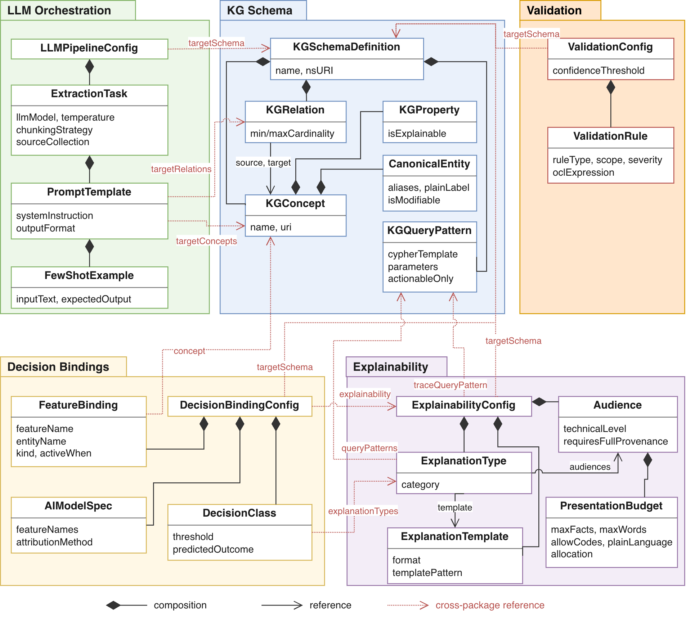

# Phase 1 — The XAI-KG metamodel (M2)

The five concerns of a KG-based explanation pipeline are reified as five **packages of one metamodel** ([`xaikg-mde/metamodels/xaikg.ecore`](../xaikg-mde/metamodels/xaikg.ecore)); every case-study model of Phase 1 conforms to it (paper, Section 4.2, *Phase 1: Modeling the Pipeline*). Three auxiliary metamodels type the intermediate models of the transformations; they are documented in [transformations.md](transformations.md).

## Packages and root classes

Each model has one root class. The roots of the four other models reference the root of the KG Schema model (`targetSchema`), and the Decision Binding root also references the Explainability root (`explainability`). The schema is therefore the single point of reference of the pipeline (R1) and the explanation contract is explicit (R5).

| Package (nsPrefix) | Model written by | Root class | Classes |
|---|---|---|---|
| KG Schema (`kgschema`) | domain experts | `KGSchemaDefinition` | `KGSchemaDefinition`, `KGConcept`, `CanonicalEntity`, `KGProperty`, `KGRelation`, `KGQueryPattern`; enumerations `PropertyDataType` |
| LLM Pipeline (`llmorchestration`) | AI engineers | `LLMPipelineConfig` | `LLMPipelineConfig`, `ExtractionTask`, `PromptTemplate`, `FewShotExample`, `ChunkingStrategy`; enumerations `SplitterType`, `OutputFormat` |
| Validation Policy (`validation`) | compliance officers | `ValidationConfig` | `ValidationConfig`, `ValidationRule`; enumerations `ValidationSeverity`, `ValidationRuleType`, `RuleScope` |
| Explainability (`explainability`) | compliance officers | `ExplainabilityConfig` | `ExplainabilityConfig`, `Audience`, `PresentationBudget`, `ExplanationType`, `ExplanationTemplate`; enumerations `ExplanationCategory`, `TechnicalLevel`, `TemplateFormat`, `FactAllocation` |
| Decision Bindings (`decision`) | AI engineers | `DecisionBindingConfig` | `DecisionBindingConfig`, `AIModelSpec`, `DecisionClass`, `FeatureBinding`; enumerations `AttributionMethod`, `BindingKind` |

## Cross-package references

All cross-package references are typed and therefore checked when the models are loaded (a dangling one is reported before the constraint layer runs, see [E2](experiments.md#e2--fault-detection-by-mutation-analysis)). They all lead to the KG Schema or the Explainability package.

| From | Reference | To |
|---|---|---|
| `LLMPipelineConfig` (LLM Pipeline) | `targetSchema` | `KGSchemaDefinition` (KG Schema) |
| `PromptTemplate` (LLM Pipeline) | `targetConcepts` [0..*] | `KGConcept` (KG Schema) |
| `PromptTemplate` (LLM Pipeline) | `targetRelations` [0..*] | `KGRelation` (KG Schema) |
| `ValidationConfig` (Validation Policy) | `targetSchema` | `KGSchemaDefinition` (KG Schema) |
| `ExplainabilityConfig` (Explainability) | `targetSchema` | `KGSchemaDefinition` (KG Schema) |
| `ExplainabilityConfig` (Explainability) | `traceQueryPattern` | `KGQueryPattern` (KG Schema) |
| `ExplanationType` (Explainability) | `queryPatterns` [0..*] | `KGQueryPattern` (KG Schema) |
| `DecisionBindingConfig` (Decision Bindings) | `targetSchema` | `KGSchemaDefinition` (KG Schema) |
| `DecisionBindingConfig` (Decision Bindings) | `explainability` | `ExplainabilityConfig` (Explainability) |
| `DecisionClass` (Decision Bindings) | `explanationTypes` [0..*] | `ExplanationType` (Explainability) |
| `FeatureBinding` (Decision Bindings) | `concept` | `KGConcept` (KG Schema) |

*11 cross-package references in total.*

## Classes by package

attributes with their types; references with their target class; `[*]` = many-valued; ◆ marks a containment reference.

### KG Schema

| Class | Attributes | References |
|---|---|---|
| `KGSchemaDefinition` | name: String, nsURI: String, description: String | ◆ concepts → KGConcept[*], ◆ relations → KGRelation[*], ◆ queryPatterns → KGQueryPattern[*] |
| `KGConcept` | name: String, description: String, uri: String | ◆ properties → KGProperty[*], ◆ canonicalEntities → CanonicalEntity[*] |
| `CanonicalEntity` | name: String, description: String, aliases: String[*], pattern: String, isModifiable: Boolean, plainLabel: String | – |
| `KGProperty` | name: String, description: String, dataType: PropertyDataType, isRequired: Boolean, isExplainable: Boolean | – |
| `KGRelation` | id: String, name: String, semantics: String, minCardinality: Int, maxCardinality: Int | source → KGConcept, target → KGConcept |
| `KGQueryPattern` | name: String, description: String, cypherTemplate: String, parameters: String[*], actionableOnly: Boolean | – |

### LLM Pipeline

| Class | Attributes | References |
|---|---|---|
| `LLMPipelineConfig` | name: String, description: String | targetSchema → KGSchemaDefinition, ◆ extractionTasks → ExtractionTask[*] |
| `ExtractionTask` | name: String, description: String, llmModel: String, temperature: Double, maxTokens: Int, sourceCollection: String | ◆ promptTemplate → PromptTemplate, ◆ chunkingStrategy → ChunkingStrategy |
| `PromptTemplate` | name: String, systemInstruction: String, outputFormat: OutputFormat | targetConcepts → KGConcept[*], targetRelations → KGRelation[*], ◆ fewShotExamples → FewShotExample[*] |
| `FewShotExample` | name: String, inputText: String, expectedOutput: String | – |
| `ChunkingStrategy` | chunkSize: Int, overlap: Int, splitter: SplitterType | – |

### Validation Policy

| Class | Attributes | References |
|---|---|---|
| `ValidationConfig` | name: String, description: String, confidenceThreshold: Double | targetSchema → KGSchemaDefinition, ◆ rules → ValidationRule[*] |
| `ValidationRule` | name: String, description: String, ruleType: ValidationRuleType, scope: RuleScope, oclExpression: String, severity: ValidationSeverity, errorMessage: String | – |

### Explainability

| Class | Attributes | References |
|---|---|---|
| `ExplainabilityConfig` | name: String, description: String, retrievalLimit: Int | targetSchema → KGSchemaDefinition, traceQueryPattern → KGQueryPattern, ◆ audiences → Audience[*], ◆ explanationTypes → ExplanationType[*], ◆ templates → ExplanationTemplate[*] |
| `Audience` | role: String, technicalLevel: TechnicalLevel, informationNeeds: String, requiresFullProvenance: Boolean | ◆ presentationBudget → PresentationBudget |
| `PresentationBudget` | maxFacts: Int, maxWords: Int, allowCodes: Boolean, plainLanguage: Boolean, allocation: FactAllocation | – |
| `ExplanationType` | name: String, category: ExplanationCategory, description: String | queryPatterns → KGQueryPattern[*], audiences → Audience[*], template → ExplanationTemplate |
| `ExplanationTemplate` | name: String, format: TemplateFormat, templatePattern: String | – |

### Decision Bindings

| Class | Attributes | References |
|---|---|---|
| `DecisionBindingConfig` | name: String | targetSchema → KGSchemaDefinition, explainability → ExplainabilityConfig, ◆ aiModel → AIModelSpec, ◆ decisionClasses → DecisionClass[*], ◆ featureBindings → FeatureBinding[*] |
| `AIModelSpec` | name: String, version: String, taskType: String, trainingDataset: String, attributionMethod: AttributionMethod, featureNames: String[*] | – |
| `DecisionClass` | name: String, label: String, positive: Boolean, predictedOutcome: String, threshold: Double | explanationTypes → ExplanationType[*] |
| `FeatureBinding` | featureName: String, description: String, kind: BindingKind, entityName: String, valueMap: String, activeWhen: String | concept → KGConcept |
