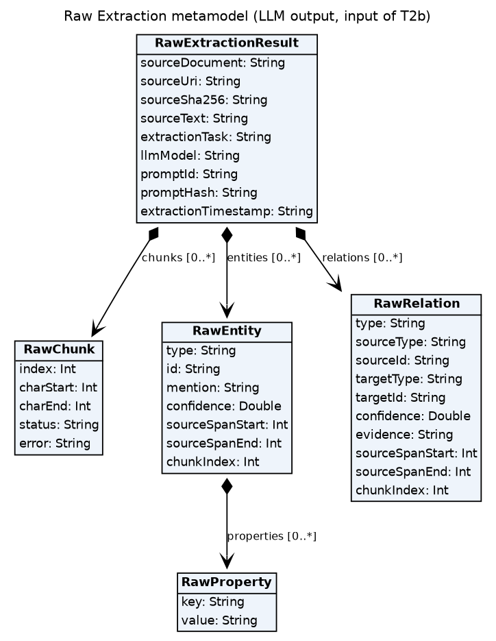

# Transformations T1–T6

*Paper: Section 4.4 (Phase 3: Generating the Pipeline) and Section 4.5 (Phase 4: Building the Knowledge Graph).
Code: [`xaikg-mde/transformations/`](../xaikg-mde/transformations/), run by the Java CLI in [`xaikg-mde/src/`](../xaikg-mde/src/).*

Once the models pass the constraint layer ([constraints.md](constraints.md)), transformations derive every runtime artifact. Model-to-model (M2M) transformations, written in the Epsilon Transformation Language (ETL), produce **intermediate models** that conform to three auxiliary metamodels. Model-to-text (M2T) transformations, written in the Epsilon Generation Language (EGL, with EGX coordination scripts), produce **executable artifacts**. Nothing in [`generated/`](../generated/) is written by hand: every file is regenerated from the models.

## Overview

| | Kind | Language and files | Input | Output | Phase | CLI command |
|---|---|---|---|---|---|---|
| **T1** | M2M | ETL: [`t1_schema2graph.etl`](../xaikg-mde/transformations/t1_schema2graph.etl) | KG Schema model | Graph Schema model [`generated/graph-schema.xmi`](../generated/graph-schema.xmi) | 3 | `generate` |
| **T3** | M2T | EGL: [`t3_graph2ddl.egl`](../xaikg-mde/transformations/t3_graph2ddl.egl) | Graph Schema model | Cypher DDL [`generated/schema.cypher`](../generated/schema.cypher) | 3 | `generate` |
| **T4** | M2T | EGX + EGL: [`t4_prompts.egx`](../xaikg-mde/transformations/t4_prompts.egx), [`t4_prompt.egl`](../xaikg-mde/transformations/t4_prompt.egl), [`t4_prompt_json.egl`](../xaikg-mde/transformations/t4_prompt_json.egl) | KG Schema + LLM Pipeline models | one prompt and one side-car per extraction task, prompt registry ([`generated/prompts/`](../generated/prompts/)) | 3 | `generate` |
| **T6** | M2T | EGX + EGL: [`t6_service.egx`](../xaikg-mde/transformations/t6_service.egx) and seven `t6_*.egl` templates | Explainability (+ KG Schema, Decision Bindings) models | explanation service ([`generated/service/`](../generated/service/)) | 3 | `generate` |
| **T2a** | higher-order (generates a validator) | EGL: [`t2a_policy2evl.egl`](../xaikg-mde/transformations/t2a_policy2evl.egl) | Validation Policy model | executable EVL validator [`generated/validated/validation.evl`](../generated/validated/validation.evl) | 3 | `t2` |
| **T2b** | M2M | ETL: [`t2b_raw2validated.etl`](../xaikg-mde/transformations/t2b_raw2validated.etl) | raw extraction models + verdicts of the generated validator | Validated KG model [`validated-kg.xmi`](../generated/validated/validated-kg.xmi) and [`rejection-report.json`](../generated/validated/rejection-report.json) | 4 | `t2` |
| **T5** | M2T | EGL: [`t5_loader.egl`](../xaikg-mde/transformations/t5_loader.egl) | Validated KG model | Cypher loader [`generated/load.cypher`](../generated/load.cypher) | 4 | `t5` |

The `generate` command runs the constraint check and then T1, T3, T4 and T6; it refuses to run any transformation if a blocking invariant fails. The `t2` command runs **T2a and T2b in sequence**: it first generates the validator (the Phase 3 artifact), then applies it to the raw extraction models (Phase 4). The make targets wrap these commands: `make generate`, `make validate` (T2a and T2b) and `make load` (T5, then the loader is executed against Neo4j).

## T1 and T3: graph schema and database schema

T1 maps the KG Schema model to a property-graph schema model: each `KGConcept` becomes a node label (with a uniqueness constraint on its first required property), each `KGRelation` a relationship type between its endpoint labels, and each `KGProperty` a typed property. T3 turns that model into an idempotent Cypher script of constraints and indexes, applied with `make ddl-apply`.


## T4: schema-aware prompts

T4 generates one prompt per `ExtractionTask` of the LLM Pipeline model. Everything schema-related in a prompt is **read from the models**: the concepts, properties and relations the task targets, their cardinalities and meaning, and the few-shot examples. Nothing is written by hand per task. The prompt also fixes the **output contract** of the LLM: every entity must come with a `mention`, the exact text span *copied verbatim* from the document chunk, and every relation with its `evidence`, the sentence that states it, *verbatim*, each with its character offsets. This is what makes grounding verifiable later ([runtime.md](runtime.md#span-location), [kg-construction.md](kg-construction.md)).

For each task, T4 writes the prompt (`<task>.txt`) and a machine-readable **side-car** (`<task>.json`: targets, chunking strategy, LLM, sampling parameters), which the Python pipeline reads instead of interpreting the models itself. Every prompt is registered in [`prompt-registry.json`](../generated/prompts/prompt-registry.json) under a **content-derived version** (`<task>@<first 12 hex digits of the prompt's SHA-256>`, for example `drug_label_extraction@fc3d922aa277`). The LLM response cache is keyed by this version, so a prompt that does not change never calls the LLM again.

## T2: validation as a higher-order transformation

Validation follows a different route, because its rules are themselves model elements.

**T2a** compiles the Validation Policy model into an executable EVL validator, with one EVL constraint per `ValidationRule`: the rule's OCL-style expression becomes the check and its error message becomes the text reported when the check fails; an `ERROR` rule becomes a blocking constraint (the item is rejected) and a `WARNING` rule a critique (the item is kept and the warning recorded). The confidence threshold comes from the policy. In the case study, the 12 rules give 7 entity-scoped and 5 relation-scoped checks. A changed rule thus changes the validator without any programming, and the generated validator is itself part of the audit trail.

**T2b** applies the generated validator to the raw extraction models (one per document and extraction task) and builds the Validated KG model. Every accepted fact carries its provenance (source document and span, extraction task, LLM, prompt version, policy version, the verdict of every rule), its canonical name and its modifiability; every rejected item names the rule it failed.




## T5: graph loader

T5 generates a Cypher script that writes each accepted fact to the graph. Domain nodes are merged on their canonical key, so all mentions of an entity become one node, which keeps a provenance link to each source: an `EXTRACTED_FROM` relationship to its source document (with the character span) and a `PRODUCED_BY` relationship to the extraction run. Relationships are merged on their fact identifier, so a relation extracted twice from the same sentence (overlapping chunks) becomes one relationship. Only accepted, provenance-tagged facts reach the graph.

## T6: explanation service

| File | Content |
|---|---|
| [`app.py`](../generated/service/app.py), [`router.py`](../generated/service/router.py) | FastAPI application; **one endpoint per pair of explanation type and audience** declared in the contract, plus `/contract` and a provenance endpoint |
| [`contract.json`](../generated/service/contract.json) | the explanation contract: audiences, budgets, explanation types, templates, trace pattern |
| [`patterns.json`](../generated/service/patterns.json) | the read-only query patterns of the KG Schema model |
| [`bindings.json`](../generated/service/bindings.json) | decision classes and feature bindings (feature → KG concept and canonical entity) |
| [`coverage.json`](../generated/service/coverage.json) | the coverage matrix: which audience is served by which explanation type (used in E5) |
| [`templates/*.j2`](../generated/service/templates/) | one rendering template per explanation type |
| [`generation-manifest.json`](../generated/service/generation-manifest.json) | the fingerprints of the models behind the service |

The generated router calls the explanation runtime of the Python project (`xaikg.explain.runtime`). The two files in [`generated/service/examples/`](../generated/service/examples/) are sample requests (a high-risk and a low-risk encounter) for trying the service; they are not produced by T6.

## Fingerprints

Every generated artifact records the **SHA-256 fingerprint of each model it was derived from**: Cypher and EVL files in a header (`// input: Schema:kg-schema.xmi sha256=…`), JSON artifacts in a `sourceModels` field. The explanation service copies the fingerprints of its generation manifest into every logged explanation, so an auditor can tell exactly which model versions produced it ([runtime.md](runtime.md#the-explanation-log)).

## Regenerating

```bash
make generate        # check + T1, T3, T4, T6 -> generated/
make validate        # T2a + T2b -> generated/validated/
make load            # T5 -> generated/load.cypher, executed against Neo4j
```

Regenerating from the committed models gives the same artifacts as the committed `generated/` folder, apart from the generation timestamps.
