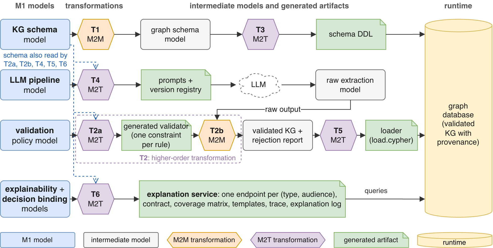
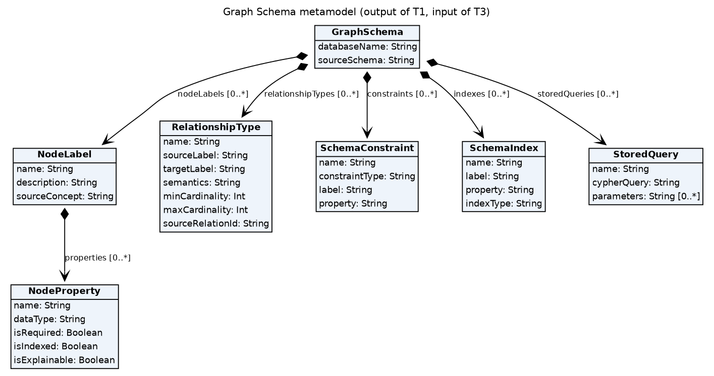
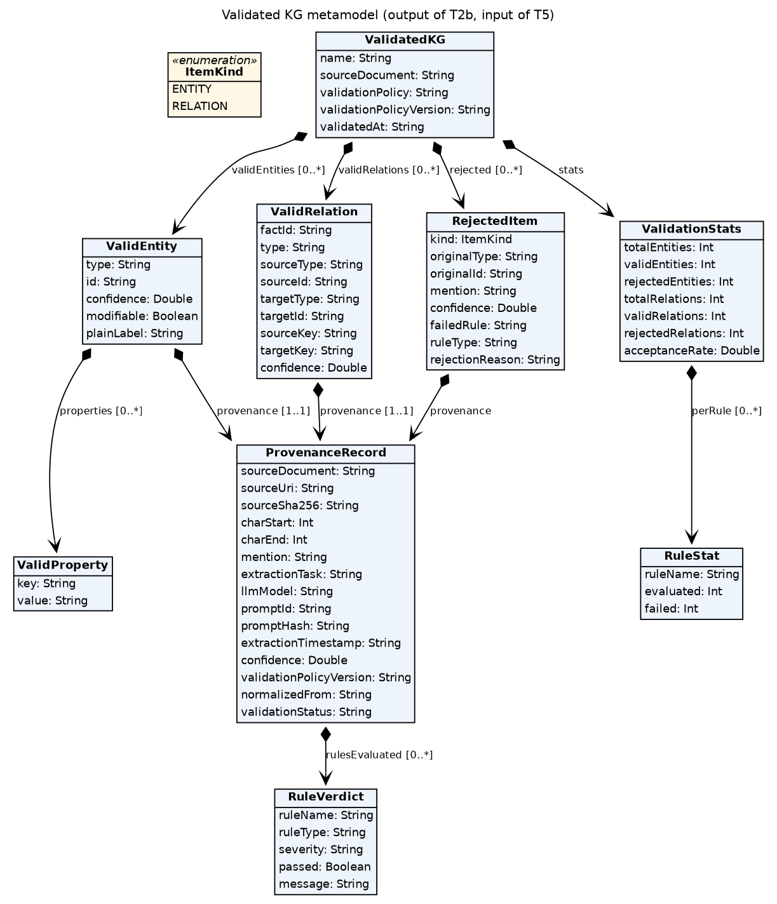

# Transformations
 
The transformations turn the five checked models into the runtime of the pipeline. They cover Phase 3 of the paper (generating the pipeline) and the validation and loading steps of Phase 4 (building the knowledge graph). They are written in the Epsilon languages, stored in `xaikg-mde/transformations/` and run by the Java command-line tool of `xaikg-mde`.
 
Two kinds of transformation are used. Model-to-model (M2M) transformations, written in ETL, produce intermediate models that conform to three auxiliary metamodels. Model-to-text (M2T) transformations, written in EGL and coordinated by EGX scripts, produce the executable artifacts stored in `generated/`.
 

 
The figure reads from left to right, one row per M1 model. T1 and T3 derive the database schema, T4 the prompts, T2 the validator and the validated graph, T5 the loader and T6 the explanation service. The LLM is the only step of the chain that is not a transformation: it runs the generated prompts, and its raw output is stored as a model before validation.
 
## Inputs and outputs
 
| | Kind | Files | Input models | Output | Phase | Command |
|---|---|---|---|---|---|---|
| T1 | M2M (ETL) | `t1_schema2graph.etl` | KG Schema | graph-schema model `generated/graph-schema.xmi` | 3 | `generate` |
| T3 | M2T (EGL) | `t3_graph2ddl.egl` | graph-schema model | Cypher DDL `generated/schema.cypher` | 3 | `generate` |
| T4 | M2T (EGX, EGL) | `t4_prompts.egx`, `t4_prompt.egl`, `t4_prompt_json.egl` | KG Schema, LLM Pipeline | one prompt and one side-car file per extraction task, and the prompt registry, in `generated/prompts/` | 3 | `generate` |
| T6 | M2T (EGX, EGL) | `t6_service.egx` and seven `t6_*.egl` templates | Explainability, Decision Binding, KG Schema | explanation service in `generated/service/` | 3 | `generate` |
| T2a | M2T (EGL), first step of T2 | `t2a_policy2evl.egl` | Validation Policy, KG Schema | EVL validator `generated/validated/validation.evl` | 3 | `t2` |
| T2b | M2M (ETL), second step of T2 | `t2b_raw2validated.etl` | raw-extraction models and the verdicts of the generated validator, KG Schema, Validation Policy | validated-KG model `generated/validated/validated-kg.xmi` and `rejection-report.json` | 4 | `t2` |
| T5 | M2T (EGL) | `t5_loader.egl` | validated-KG model, KG Schema | Cypher loader `generated/load.cypher` | 4 | `t5` |
 
The `generate` command first runs the constraint check and stops if a blocking invariant fails; otherwise it runs T1, T3, T4 and T6. The `t2` command runs T2a and then T2b: it generates the validator and applies it to the raw-extraction models. The make targets wrap these commands (`make generate`, `make validate` for T2, `make load` for T5 followed by the execution of the loader in Neo4j).
 
## T1 and T3: graph schema and database schema
 
T1 maps the KG Schema model to a property-graph schema. Each `KGConcept` becomes a node label with a uniqueness constraint on its first required property, each `KGRelation` a relationship type between its endpoint labels, and each `KGProperty` a typed property. T3 writes this model as an idempotent Cypher script of constraints and indexes, applied with `make ddl-apply`.
 
## T4: prompts
 
T4 generates one prompt per `ExtractionTask` of the LLM Pipeline model. The schema-related content of a prompt comes from the models: the targeted concepts, properties and relations, their cardinalities and descriptions, and the few-shot examples. The prompt also fixes the output format expected from the LLM. Every entity comes with a `mention`, the span copied verbatim from the document chunk, and every relation with its `evidence`, the sentence that states it, also copied verbatim. Both carry their character offsets. The grounding rules of the validator later check these quotations against the source.
 
For each task, T4 also writes a side-car file (`<task>.json`) with the targets, the chunking strategy, the LLM and the sampling parameters; the Python pipeline reads this file and never interprets the models itself. Each prompt is registered in `generated/prompts/prompt-registry.json` under a content-derived version, made of the task name and the first 12 hexadecimal digits of the SHA-256 of the prompt (for example `drug_label_extraction@fc3d922aa277`). The LLM response cache uses this version as part of its key, so an unchanged prompt does not call the LLM again.
 
## T2: a higher-order transformation
 
The validation rules are elements of the Validation Policy model, so the validator itself is generated.
 
T2a compiles the policy into an EVL validator with one EVL check per `ValidationRule`. The OCL-style expression of the rule becomes the condition of the check and its error message the reported text. A rule of severity `ERROR` becomes a blocking constraint, which rejects the item; a rule of severity `WARNING` becomes a critique, which keeps the item and records the warning. The confidence threshold is read from the policy. In the case study, the 12 rules give 7 entity checks and 5 relation checks. Changing a rule in the model therefore changes the validator without programming, and the generated validator can be inspected as part of the audit trail.
 
T2b applies the generated validator to the raw-extraction models (one per document and extraction task) and builds the validated-KG model. Each accepted fact carries its provenance (source document and span, extraction task, LLM, prompt version, policy version and the verdict of every rule), its canonical name and its modifiability. Each rejected item names the rule it failed.
 
## T5: graph loader
 
T5 generates the Cypher script that writes the accepted facts to the graph. Domain nodes are merged on their canonical key, so all mentions of an entity become one node. The node is linked to the documents it was extracted from by `EXTRACTED_FROM` relationships, which carry the character span, and to the extraction runs that produced it by `PRODUCED_BY` relationships. Relationships are merged on their fact identifier, so a relation extracted twice from overlapping chunks is loaded once. Rejected items never reach the graph.
 
## T6: explanation service
 
| File | Content |
|---|---|
| `app.py`, `router.py` | FastAPI application with one endpoint per pair of explanation type and audience, plus a `/contract` endpoint and a provenance endpoint |
| `contract.json` | audiences, budgets, explanation types, templates and trace pattern |
| `patterns.json` | the read-only query patterns of the KG Schema model |
| `bindings.json` | decision classes and feature bindings (feature to KG concept and canonical entity) |
| `coverage.json` | coverage matrix: the explanation types that serve each audience (used in E5) |
| `templates/*.j2` | one rendering template per explanation type |
| `generation-manifest.json` | fingerprints of the models behind the service |
 
The generated router calls the explanation runtime of the Python project (`xaikg.explain.runtime`). The folder `generated/service/examples/` is the only hand-written part of `generated/`: it contains two sample requests, for a high-risk and a low-risk encounter.
 
## Intermediate metamodels
 
The three auxiliary metamodels are in `xaikg-mde/metamodels/`.
 
Graph schema (output of T1, input of T3):
 

 
Raw extraction (LLM output, input of T2b):
 

 
Validated KG (output of T2b, input of T5):
 

 
## Fingerprints
 
Each generated artifact records the SHA-256 fingerprints of the models loaded for its generation: Cypher and EVL files in their header (`// input: Schema:kg-schema.xmi sha256=…`), JSON files in a `sourceModels` field. The explanation service copies the fingerprints of its generation manifest into every logged explanation, so that each explanation can be traced to the model versions that produced it.
 
## Regenerating
 
```bash
make generate        # constraint check, then T1, T3, T4, T6
make validate        # T2a, T2b
make load            # T5, then the loader is executed in Neo4j
```
 
Regenerating from the committed models gives the same artifacts as the committed `generated/` folder, except for the generation timestamps.
 